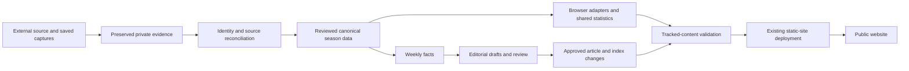

# Architecture

## Records with different responsibilities

| Layer | Purpose | Change rule |
|---|---|---|
| Raw and normalized source captures | Preserve exactly what a source returned | Retain provenance and hashes; do not repair evidence to satisfy a validator |
| Reconciliation | Resolve source disagreement and human attribution | Require explicit evidence; do not merge people from names or team IDs alone |
| Canonical history | Supply approved season facts | Controlled refresh, validated against the applicable source scope |
| Shared statistics | Produce consistent member/career calculations | Reuse one calculation path across consumers |
| Weekly facts | Ground recap and ranking content | Stage and validate the bounded output set before promotion |
| News articles and index | Present reviewed editorial content | Separate approval and finalization from fact generation |

## Current identity versus historical meaning

A team can change its current display name without changing who owned historical results. The inspected current-name workflow preserves stable association rules and separates current selectors from captured historical labels. This prevents a cosmetic rename from accidentally altering history or career totals.

## Static delivery, substantial tooling

The public frontend is static, but the maintenance workflow is not merely manual HTML editing. Node.js scripts and validators manage canonical refreshes, article facts, approval/finalization and consistency checks. A Python build tool also exists for the matchup explorer. This is a useful portfolio distinction: application complexity can live in data and delivery tooling without requiring a dynamic production backend.

## Boundaries

The full local audit depends on private evidence that is not available in an ordinary tracked checkout. CI checks the tracked scope and reports that limit explicitly. The showcase describes these boundaries but supplies no production configuration or private identifiers.
