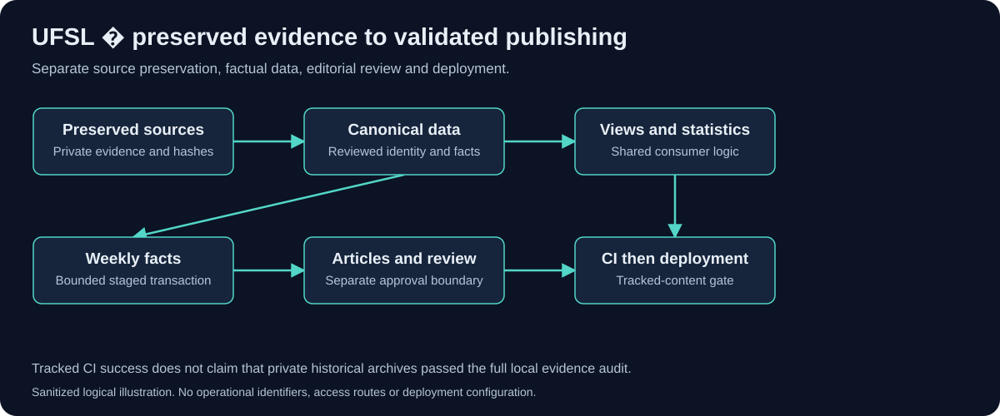

# UFSL � Fantasy Sports Data and Publishing

A static fantasy sports website backed by JavaScript data tooling, historical-source preservation and validation gates. Visitors can browse league news, seasons, members and historical results without access to the private development repository.

**Live demonstration:** [ufsl.club](https://ufsl.club/). The homepage returned HTTP 200 during the October 31, 2026 review. This was a reachability check, not a complete live-site functional test.

## Why it exists

League history spans multiple seasons and source systems. Rebuilding the site required more than moving pages: it required preserving evidence, reconciling identities and separating facts from generated editorial content. I wanted current updates to fit a repeatable process without silently changing historical research.

## My contribution

My work covers the website modernization, canonical data structure, migration and reconciliation tooling, shared member-statistics logic, weekly publishing workflow and deployment validation. The inspected source contains Node.js scripts, tests, architecture contracts and historical-preservation documentation. ESPN is an external data source; I do not claim ownership of its platform or data rights.

## What visitors can evaluate

- A browser-based view of league news, member profiles, seasons and history.
- A canonical data approach covering the documented 2012�2026 season range.
- A distinction between historical labels and current team-name display metadata.
- An engineering process that validates factual and editorial outputs before deployment.



## Architecture and decisions

The site uses HTML, CSS and JavaScript with JSON data. Offline tools turn preserved sources into reviewed canonical data. Browser adapters and shared statistics logic consume that canonical layer. Weekly recap data and article publication have separate change boundaries.

The [architecture](ARCHITECTURE.md) explains the flow. The [migration case study](DATA-MIGRATION.md) explains missing data, provenance, identity and preserved historical evidence. The [validation and CI/CD walkthrough](VALIDATION-AND-CICD.md) distinguishes full local evidence from tracked checkout validation.

## Testing and current status

The latest inspected GitHub Actions run completed tracked-content validation and deployment successfully. The preceding inspected run failed tracked-content validation and skipped deployment, providing concrete evidence that the deployment dependency was enforced in those runs.

The full private historical-evidence audit was not rerun here. A passing tracked-content job explicitly does not claim that private archives passed. The task tracker also retains publication-placement validation work and a reported news-image regression as open. They are described in [limitations and engineering lessons](ENGINEERING-NOTES.md).

## Safe review route

Start with the public website and this case study. The private source contains league/member research, operational publishing contracts and archive references; it should remain private. This showcase includes no league account identifiers, private payloads, authenticated data-fetch commands, production workflow files or raw migration archives.

The [synthetic migration example](evaluation/MIGRATION-EXAMPLE.md) illustrates identity and missing-value handling without copying real league records.


## Run the code in this repository

Requires Node.js 18 or newer. No package installation, credentials, network connection or deployment is needed.

```text
npm test
npm run demo
```

See [source provenance, scope and evaluation](CODE-REVIEW.md). Tests exercise the standalone code, not the private production system. This repository has a clean history and no deployment workflow. It remains private pending publication and license approval.
